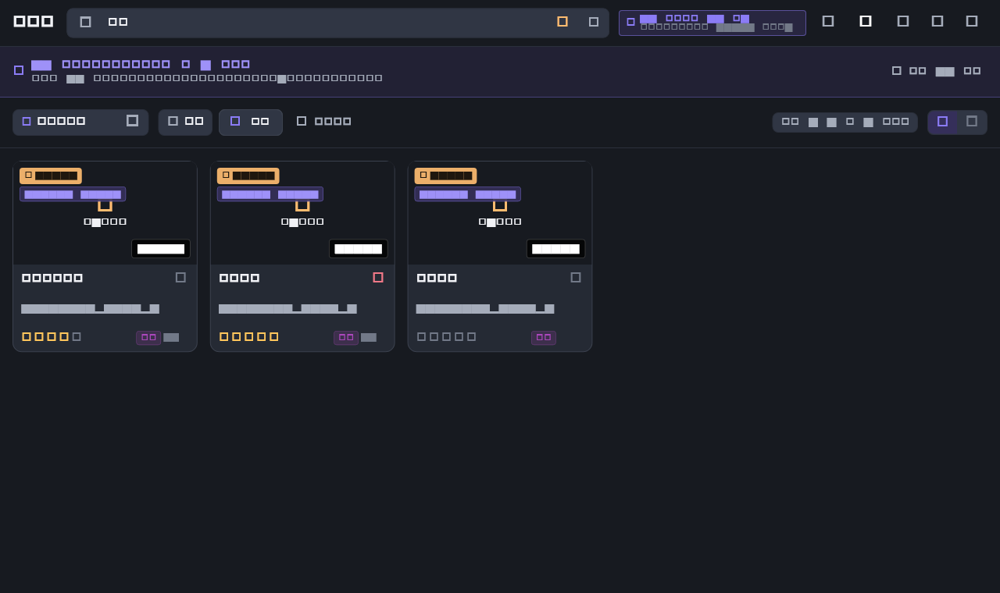
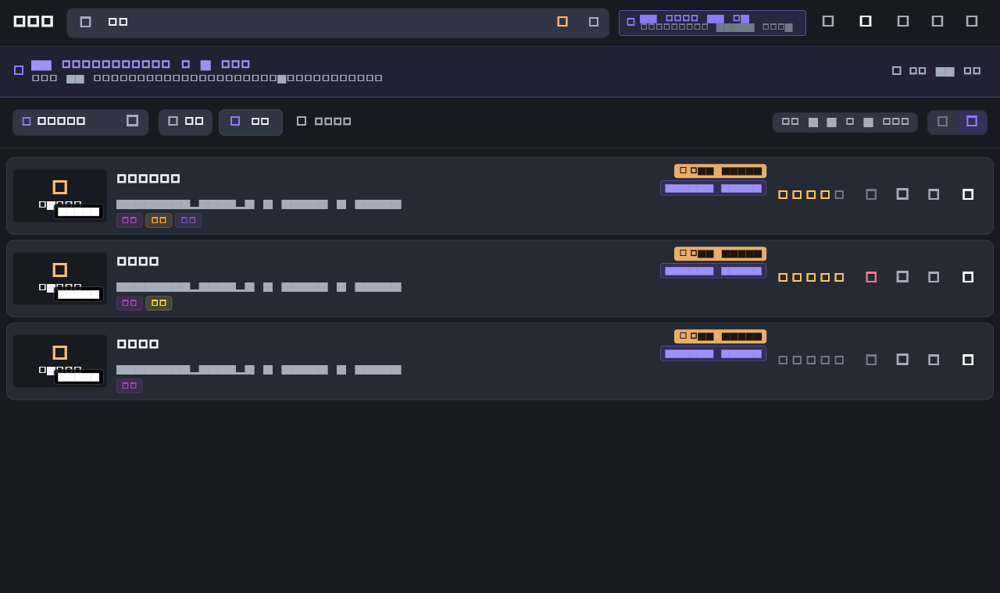
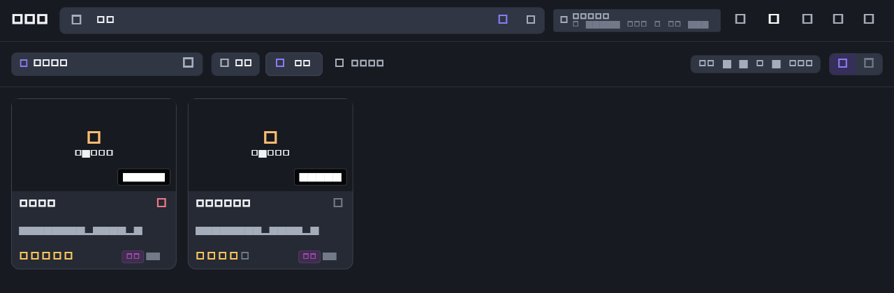

[简体中文](README.md) | [**English**](README_EN.md)

# Video Clip Manager

> A desktop video clip manager for local media: mark IN/OUT points down to the millisecond for **lossless soft clipping** (no transcoding, the original file is never rewritten), organise clips and playlists inside a dark media workspace, and — optionally — search your footage with natural language using **local AI models**.

<p align="center">
  
  
  
  
  
  <a href="https://github.com/joopererer/video_clip_manager/releases/tag/v1.1.0"></a>
</p>

## Download

Latest stable release: [**Video Clip Manager v1.1.0**](https://github.com/joopererer/video_clip_manager/releases/tag/v1.1.0)

| Platform | Asset | Status |
| --- | --- | --- |
| **Windows x64 (recommended)** | [`video_clip_manager-v1.1.0-windows-x64.zip`](https://github.com/joopererer/video_clip_manager/releases/download/v1.1.0/video_clip_manager-v1.1.0-windows-x64.zip) (~39.6 MB) | **Portable ZIP, manually verified on real hardware** |
| Windows x64 (CI build) | `video_clip_manager-windows-x64.zip` (~40.9 MB) | Built by GitHub Actions from the same commit, **not manually tested**, different archive layout |
| macOS | `video_clip_manager-macos.zip` | CI build, not manually tested |
| Linux x64 | `video_clip_manager-linux-x64.tar.gz` | CI build, not manually tested |

> **Please pick the versioned `video_clip_manager-v1.1.0-windows-x64.zip`.** The same release also carries an unversioned `video_clip_manager-windows-x64.zip`, which is a CI rebuild produced on a GitHub Runner: it has no top-level folder and its binaries are not byte-identical to the verified package. Use the SHA-256 below to tell them apart.
>
> Recommended package checksum: `SHA-256 500C9081850F2F6F5132252D74ACC0CB8301B7975E090CCC9FFB826C1B132349` (41,516,055 bytes, ~96.6 MB / 30 files once extracted). Verify with: `Get-FileHash .\video_clip_manager-v1.1.0-windows-x64.zip -Algorithm SHA256`

## Screenshots

> The images below were rendered by `test/v1_1_visual_verification_test.dart` using **production widgets** and can be reproduced locally. The UI text in them is Chinese. A few screens (original video preview, playlists, About) were not re-captured for this release, so they are intentionally not shown here.

**Clip library · grid view, with the cosine `Score` shown directly on results**



**Clip library · list view, showing the `HIT` timestamp and `Score`**



**Typing filters by keyword; AI semantic search only starts on `Enter` or the ✨ button**



## What's in v1.1.0

### Dark media workspace

- A responsive dark workspace: collapsible sidebar (208 px / 64 px), top bar and content area, with three pages (Clips / Original Videos / Playlists) that fold secondary actions on narrow windows instead of squeezing the content.
- The clip library offers **grid and list** views with consistent hover, keyboard focus, selection border and context-menu behaviour; empty states, missing source files and loading states all have explicit places to land.

### Original videos and clips

- **Original video management**: local files, network streams and supported online media in one table that reports source type, duration, resolution (portrait sources are labelled `portrait`) and clip count.
- **Standalone preview**: on the Original Videos page, double-click / the play button / the context-menu "Play" action opens a preview dialog (play-pause, draggable progress bar, mute, volume restore, fullscreen, one-click "Create Clip"), while the scissors button or "Create Clip" opens the editor — the two intents are fully separated.
- **Millisecond soft clipping**: a clip is metadata only, an `inMs` / `outMs` range on the original media. Nothing is transcoded, cut out or rewritten, so saving a clip costs no quality and no re-encoding wait.
- **Clip management**: grid and list views with rating, tags, favourites, search, filtering and sorting.
- **Playlists**: arrange clips into playlists with drag-to-reorder, continuous playback and cross-clip jumps; supported online / M3U8 media opens from both the clip library and playlists.
- **Playback controls**: the main player, the clip editor, the clip playback screen and the original video preview all expose a volume slider and mute toggle, and unmuting restores the previous volume instead of snapping back to 100%.

### AI semantic search (optional)

- **Search footage in plain language** — descriptions such as "a woman in a red coat turning around" recall clips by keyframe semantic similarity.
- **Hit timestamp**: matching clips show a golden `HIT` badge on the thumbnail, with the best-matching frame timecode on hover and in list rows.
- **Similarity score**: results display the real cosine similarity to three decimals (e.g. `Score: 0.871`); the tooltip states explicitly that it is **not** an accuracy or confidence value.
- **Relevance sorting**: when semantic scores exist, results default to "highest relevance", strictly descending by score; switching sort order keeps HIT and Score intact.
- **Keyword filtering is separate from AI search**: the search box always filters by keyword as you type, and only `Enter` or the ✨ button in the search box starts an AI semantic search. A status bar and result banner always show the current mode; editing the query clears stale HIT/Score immediately and late responses are discarded as a whole.
- **Model management for semantic search**: the AI settings panel reports EmbeddingGemma 2 status (ready / not downloaded / incomplete), supports a custom model directory (with an option to copy existing models), one-click download and a "repair / complete download" action that verifies each file by SHA-256 and only fetches what is missing or corrupt.
- **Local-first**: embeddings are computed on your machine; no media, model or vector data is uploaded.

### VLM descriptions (optional, external inference service)

- Connect **Ollama** (recommended: `qwen2-vl:2b`) or the **optional** local inference server **LM Studio**, plus OpenAI-/DashScope-compatible endpoints, to generate clip descriptions and atomic tags.
- LM Studio is a separate third-party local inference service, **not a bundled component** of this app. The app never starts it and never edits its configuration.

### About and updates

- The About dialog reads the **real packaged version** (v1.1.0 · build 3), the repository URL, the open-source licence list and the Releases page — no more hard-coded version strings.
- **Check for updates**: reads the newest stable GitHub release and compares it with SemVer, prompting only when the remote version is actually higher. Failures, 404s and offline situations just report "cannot check" — no error dialogs, no data uploaded.

## Download and install

The current Windows release is a **portable ZIP, not an installer**.

1. Download and extract `video_clip_manager-v1.1.0-windows-x64.zip`; you get a single folder, `video_clip_manager-v1.1.0-windows-x64\`.
2. Open that folder and run `video_clip_manager.exe`.
3. **Do not copy the EXE out on its own** — it needs the DLLs, the `data/` resources and the plugin DLLs next to it; missing any of them means it will not start or cannot play.

| Package contents | Purpose |
| --- | --- |
| `video_clip_manager.exe` | Main executable (version resource comes from `pubspec.yaml`) |
| `flutter_windows.dll`, `data/` | Flutter runtime and compiled assets — **required** |
| `libmpv-2.dll`, `media_kit_*.dll` | Playback core; removing them breaks playback |
| `onnxruntime.dll` | ONNX inference runtime |
| `d3dcompiler_47.dll`, `libEGL.dll`, `libGLESv2.dll`, `vk_swiftshader.dll`, `vulkan-1.dll`, `zlib.dll` | Graphics / decompression dependencies |
| `desktop_drop`, `url_launcher_windows`, `volume_controller` plugin DLLs | Drag-and-drop import, external links, volume control |

**The package contains no AI model weights and no `local-media-ai.exe` sidecar.** The macOS and Linux assets are CI artefacts that have not been manually tested by the maintainers — evaluate them before relying on them.

## Quick start

1. On first launch the default library lives in `Documents/VideoClipManager` (you can point it elsewhere via "Switch / New Database" in the top bar).
2. On the Original Videos page click **Add Videos → Add Local Video** to pick files, or drag video files straight into the window.
3. Double-click an original video to open the **preview** and scrub to the frame you need; click "Create Clip" or the scissors button to enter the editor.
4. Set IN / OUT (millisecond precision) together with title, tags and rating, then save — the original file is untouched.
5. Filter, rate and favourite clips in the library, or add them to a playlist for continuous playback.

Everyday features (video management, playback, soft clipping, playlists, keyword filtering) work **out of the box** and need no AI model at all.

## Configuring AI semantic search (optional)

Skip this section entirely if you only manage, play and clip videos. AI semantic search needs three extra pieces:

| Dependency | Purpose | How to get it |
| --- | --- | --- |
| **EmbeddingGemma 2** model (~530 MB) | 768-dimensional text and keyframe embeddings | Download from **Settings → AI Settings → Semantic search model** inside the app; each file is SHA-256 verified, and the model directory is configurable (defaults to `models/` next to the executable) |
| **`local-media-ai.exe`** sidecar | Frame extraction, text/image embeddings, VLM calls | This repository **does not build that binary** and the release ZIP does not include it. The sidecar comes from the separate `local-media-ai` Rust project; build it yourself and place it next to the executable (or in a `bin/` subfolder, or on the system `PATH`) |
| **FFmpeg** | Frame extraction and media decoding | Install FFmpeg the usual way from its official distribution and make sure it can be found |

If the model, the sidecar or FFmpeg is missing the app does not crash — AI settings and search show explicit guidance on what is missing and where to put it.

**About Ollama and LM Studio**: they are only used for optional **VLM descriptions / tagging** and are **not** dependencies of semantic vector search. Semantic search embeds and compares vectors locally through the sidecar and EmbeddingGemma 2, with no external service running. If you only want to search footage and do not need AI descriptions, you do not need Ollama, and you do not need LM Studio.

## Updating

- In-app: **About → Check for updates**. It reads the newest stable GitHub release, compares it with SemVer, prompts only when the remote version is higher and links to the matching release page.
- Manual: download the new archive from [Releases](https://github.com/joopererer/video_clip_manager/releases).
- **No self-overwriting installer, no forced upgrades** — downloading and installing is always your decision.
- Upgrade safety: the user database JSON schema **did not change** between 1.0.x and 1.1.0, so existing databases, thumbnails and vector caches keep working. Replace the program folder with the newly extracted one; the library defaults to `Documents/VideoClipManager` and is unaffected by version changes. If you keep models in `models/` inside the program folder, preserve that folder or re-select the model directory in AI settings.

## Building from source

### Prerequisites

- [Flutter SDK](https://flutter.dev) 3.41+ (Dart 3.11+)
- [FFmpeg](https://ffmpeg.org) (playback and frame extraction; required for AI semantic search)
- [Rust](https://rustup.rs) (optional, only for building the `local-media-ai` sidecar yourself)

### Common commands

```bash
flutter pub get
flutter run -d windows          # debug run
flutter build windows --release # release build
flutter build macos --release
flutter build linux --release
flutter test                    # 461 unit / widget tests
flutter analyze
```

Architecturally, the Flutter UI plays media through `media_kit`, plans incremental keyframe extraction with `DeltaEngine` / `FrameEmbeddingPool`, and delegates extraction and inference to the `local-media-ai` sidecar over JSON IPC in a separate process, so an inference crash cannot take the UI down:

```
┌─────────────────────────────────────────────────────────┐
│            Video Clip Manager (Flutter UI)              │
│  ClipsTab / VideosTab / PlaylistsTab / Editor / Player  │
│  AppState (Provider) · DeltaEngine · FrameEmbeddingPool │
└───────────────┬─────────────────────────┬───────────────┘
                │                         │
        ┌───────▼────────┐        ┌───────▼─────────┐
        │   media_kit    │        │  local-media-ai │
        │ (mpv playback) │        │  (Rust sidecar) │
        └────────────────┘        └───────┬─────────┘
                                          │
                        FFmpeg frames · EmbeddingGemma 2 (ONNX)
                        optional VLM: Ollama / LM Studio / OpenAI-compatible
```

### Contributing

Issues and pull requests are welcome. Before submitting, make sure `flutter analyze` reports no new errors, `flutter test` is green, and existing invariants hold (soft clips stay metadata-only, original files are never rewritten, JSON schema is unchanged). Stage reports and design documents live under [`docs/`](docs); most of them are written in Chinese.

## Known limitations

1. **Semantic search has no Top-K cut-off**: it returns every clip with `score >= 0.28`, the same threshold as v1.0.x, so weakly related results can appear. This release only surfaces the score honestly and sorts by relevance.
2. **The release archive ships neither models nor the sidecar**: a clean machine needs EmbeddingGemma 2, `local-media-ai.exe` and FFmpeg before AI visual search works — it is not "download and go".
3. **The macOS / Linux assets are CI builds** and have not been manually tested; no verification is claimed for them.
4. **Online video and scraping** depend on external tools and the network, so availability varies by platform and connection.
5. **No video transcoding or export**: the app only marks time ranges and manages metadata, it never re-encodes media.
6. **Update checks only notify**; they never install anything, and a failed check simply reports "cannot check" without retry dialogs.
7. The retrieval relevance evaluation set (`docs/ui-upgrade/semantic_eval/queries.csv`) still needs real measured scores on a machine with the model and sidecar installed.

## FAQ

**Is this an installer or a portable build?**
A portable ZIP. There is no installer — extract the whole folder and run `video_clip_manager.exe`. Deleting the folder uninstalls it; your data lives in `Documents/VideoClipManager`.

**Do I have to download the AI model?**
No. Video management, playback, soft clipping, playlists and keyword filtering need no model. Only AI semantic search requires EmbeddingGemma 2 (plus the sidecar and FFmpeg), and VLM descriptions additionally require an inference service such as Ollama or LM Studio that you provide.

**What is the difference between typing and pressing Enter?**
Typing performs **live keyword filtering** (no embeddings are computed). Only `Enter` or the ✨ button starts an **AI semantic search**, and only those results carry `HIT` timestamps and `Score`. The status bar and result banner always tell you which mode you are in.

**How do I upgrade?**
Use **About → Check for updates**, or download the new archive from Releases and replace the program folder. The library in `Documents/VideoClipManager` and the JSON schema need no migration. If you keep models in `models/` inside the program folder, preserve that folder.

**Are macOS and Linux supported?**
CI produces macOS and Linux builds, but **only the Windows x64 build has been manually verified**. Treat the macOS/Linux artefacts as untested and check them yourself.

## Version history

Highlights of v1.1.0: the full dark media workspace rebuild, standalone original-video preview, playlist authoring and continuous playback, volume sliders on all four player surfaces, real AI `Score` plus relevance sorting, keyword filtering separated from AI search, model download / verification / directory management for semantic search, and a dynamic version display with check-for-updates in About.

- Full history (including v1.0.1): [`docs/CHANGELOG.md`](docs/CHANGELOG.md)
- v1.1.0 release notes: [`docs/ui-upgrade/V1_1_RELEASE_NOTES.md`](docs/ui-upgrade/V1_1_RELEASE_NOTES.md) | [GitHub Release](https://github.com/joopererer/video_clip_manager/releases/tag/v1.1.0)
- v1.1.0 release and verification report: [`docs/ui-upgrade/V1_1_RELEASE_FINAL.md`](docs/ui-upgrade/V1_1_RELEASE_FINAL.md)

## License

Released under the [MIT License](LICENSE).
