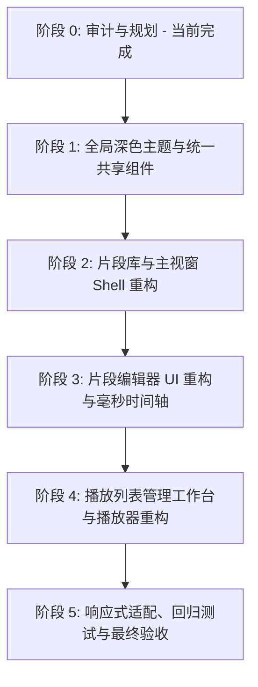

# Video Clip Manager — 代码基线审计与 UI 升级实施规划 (CODEBASE_AUDIT)

> **基线版本**: `master` (1.0.1+2)  
> **工作分支**: `feat/dark-ui-workspace`  
> **审计日期**: 2026-10-26  
> **目标**: 将桌面端应用升级为 cohesive Modern Dark Media Workspace（现代深色媒体工作台），同时 100% 保留所有业务逻辑与媒体生命周期稳定机制。

---

## 1. 基线环境与质量检查报告

### 1.1 开发与运行环境
- **Flutter SDK**: `3.41.7 • channel stable` (Dart `3.11.5`, DevTools `2.54.2`)
- **宿主系统**: Microsoft Windows [版本 10.0.26200.9711] (Windows 11 / 25H2)
- **桌面构建工具链**: Visual Studio Community 2022 (17.14.40), Windows 10 SDK (10.0.26100.0) — **Windows 桌面直接运行与构建可用**
- **已连接目标设备**: `Windows (desktop) • windows • windows-x64`

### 1.2 静态代码分析与单元测试基线
- **`flutter pub get`**: 依赖解析正常，无版本冲突。
- **`flutter analyze`**:
  - `flutter analyze --no-fatal-infos --no-fatal-warnings` 退出码为 `0`（**零编译错误**）。
  - 总共报告 1365 项静态信息（主要为测试与调试脚本中的 `avoid_print` 以及废弃变量声明警告）。
- **`flutter test`**:
  - **18 个已有单元测试全部通过**（包括 `ai_service_test.dart`、`app_state_ai_test.dart`、`delta_engine_test.dart`、`tag_utils_test.dart`、`widget_test.dart`）。
  - 覆盖了 AI 语义检索、帧向量计算缓存增量规划（DeltaEngine）、标签工具及数据加载反序列化回退逻辑。

---

## 2. 真实代码库架构与功能映射

### 2.1 状态管理与数据流
- **架构基础**: 基于 `provider` (`ChangeNotifierProvider<AppState>`)。
- **全局单一状态中枢**: `lib/data/app_state.dart`
  - 维护内存列表：`clips`, `originalVideos`, `playlists`, `onlineVideos`, `onlineVideoClips`。
  - 维护筛选与视图配置：`selectedTags`, `selectedRating`, `selectedFavorite`, `clipsIsGridView`, `playlistsSortBy` 等。
  - 负责数据持久化事务：`loadInitialData()`, `saveData()`, `switchDatabase()`, `importAndMergeClips()`。
  - 集成 AI 语义向量检索：`performSemanticSearch()`, `isSemanticSearching`, `semanticScores`, `DeltaEngine`。
- **核心数据模型与 JSON 序列化**: `lib/data/models.dart`
  - `VideoClip`: 软截取元数据模型（`start` 和 `end` 存储毫秒数 `startTime.inMilliseconds`，`coverFrameTime` 毫秒数，AI 字段 `aiSummary`, `aiScene`, `aiActions`, `hitTimestampMs`）。
  - `OriginalVideo`: 本地源视频实体（`path`, `name`, `duration`, `thumbnailPath`）。
  - `Playlist` / `PlaylistItem` / `PlaylistItemWithClip`: 播放列表数据结构，按 clip 引用进行组装，包含有效时长计算 `effectiveDuration` 与顺序索引。
  - `OnlineVideo` / `OnlineVideoClip`: 在线媒体抓取与引用模型。

### 2.2 核心服务层
- `lib/services/screenshot_service.dart`:
  - 维持长生命周期的 `Player` 与 `VideoController`。
  - **关键机制**: 单线程化执行队列 `_queue`、超时保护（`openTimeout`, `seekTimeout`）、宿主使能机制（`disableHost()`, `awaitHostReady()`, `prepareForPlayback()`）。
- `lib/services/preview_service.dart`:
  - 视频关键帧提取与预缓存、进度监听、全局预生成任务（在编辑器/播放器启动时需要 `pauseGlobalPreGeneration()` 与 `resumeGlobalPreGeneration()`）。
- `lib/services/thumbnail_service.dart`:
  - 缩略图文件磁盘缓存读写与防抖。
- `lib/services/ai_service.dart` & `delta_engine.dart` & `frame_embedding_pool.dart`:
  - 本地 EmbeddingGemma 2 向量推理与缓存增量同步引擎。

### 2.3 现有页面与功能文件映射表

| 功能模块 | 现有源码路径 | 职责与关键功能 |
| :--- | :--- | :--- |
| **应用入口** | `lib/main.dart` | 初始化 `MediaKit`、`PathService`、`SharedPreferences`，注册全局 Providers，挂载 `MaterialApp` |
| **主视窗框架** | `lib/screens/main_screen.dart` | 主窗口 Shell、顶栏 actions、搜索栏（AI 语义检索集成）、拖拽导入（`desktop_drop`）、**离屏 Video 截图宿主组件** |
| **片段库标签** | `lib/screens/tabs/clips_tab.dart` | 片段列表/网格渲染、多条件过滤、排序、右键/菜单、悬浮预览播放 |
| **原始视频标签** | `lib/screens/tabs/videos_tab.dart` | 本地与在线视频混合视图、文件/目录导入、拖拽处理 |
| **播放列表标签** | `lib/screens/tabs/playlists_tab.dart` | 播放列表汇总指标、列表/网格展示、新建/导入/导出入口 |
| **片段编辑器** | `lib/screens/player/clip_editor_screen.dart` | 视频播放与时间轴、`MultiSplitView` 布局、IN/OUT 选点、AI 自动标注、封面抓取 |
| **在线片段编辑** | `lib/screens/player/online_clip_editor_screen.dart` | 在线流媒体的 IN/OUT 截取与属性配置 |
| **片段独立播放** | `lib/screens/player/clip_playback_screen.dart` | 单片段播放浮层、相对/绝对进度切换、片段间快捷切换 |
| **播放列表管理** | `lib/screens/playlist/playlist_management_screen.dart` | 播放列表工作台、草稿项重排、比例时间轴、Save/Reset 事务提交 |
| **播放列表播放器**| `lib/screens/player/playlist_playback_screen.dart` | 连续播放引擎、跨 clip 跳转、全局进度与片段进度联动、多播放模式 |
| **播放列表时间轴**| `lib/widgets/playlist_timeline_view.dart` | 按时长比例渲染的色块时间轴、拖拽重排指示器、选中反馈 |
| **自定义进度条** | `lib/widgets/custom_progress_bar.dart` | 精确时间线滑块、鼠标悬停缩略图浮窗、范围指示 |

---

## 3. 业务不变量与受保护逻辑清单（绝对不可破坏）

在实施 Dark UI 升级时，以下机制属于**核心业务不变量**，任何 UI/主题改动均严禁破坏：

1. **软截取（Soft-Clipping）元数据语义**:
   - 截取操作仅记录 `startTime` 与 `endTime`（毫秒精度），原始音视频文件保持 100% 只读完整，不得触发任何重编码或裁剪导出。
   - 存储时间单位必须严格保持毫秒（`inMilliseconds`），展示层使用 `timecode` 格式化器转换为 `HH:MM:SS.mmm`。
2. **`ScreenshotService` 离屏渲染宿主与调用契约**:
   - `lib/screens/main_screen.dart` 底部必须保留定位在视口外的 `Video(controller: ScreenshotService().videoController)` 组件。
   - 严禁并发触发截图与 seek 操作，必须通过 `ScreenshotService().takeScreenshot()` 的串行队列进行。
   - 打开可见播放器（如编辑器或播放窗口）前，必须调用 `ScreenshotService().prepareForPlayback()`，避免 Windows DirectX 纹理冲突。
3. **`PreviewService` 全局预生成生命周期协调**:
   - 进入 `ClipEditorScreen` / `ClipPlaybackScreen` / `PlaylistPlaybackScreen` 时必须调用 `PreviewService().pauseGlobalPreGeneration()`。
   - 退出销毁（`dispose()`）时必须调用 `resumeGlobalPreGeneration()`。
4. **播放器实例（Media Kit `Player`）生命周期**:
   - 严禁在 Widget 的 `build()` 方法中实例化 `Player` 或 `VideoController`。
   - 必须在 `State.initState()` 中初始化并在 `State.dispose()` 中显式 `player.dispose()`。
5. **播放列表事务编辑机制（Transactional Draft State）**:
   - `PlaylistManagementScreen` 中的拖拽重排和删除操作必须保存在本地编辑副本（`_editingItems`）中。
   - 只有当用户显式点击「保存」时才提交到 `AppState`；点击「重置」或「取消」时还原 `_originalItems`，如有未保存改动需有防误触提醒。
6. **AI 搜索与在线功能完整性**:
   - `AppState.performSemanticSearch()`、模型检测对话框、AI 生成片段摘要功能必须与搜索栏无缝集成，不可因深色 UI 改造而被剥离。
   - 保留在线视频与爬虫模块（`OnlineVideo`, `ExternalScrapersSettingsScreen`）。
7. **Windows 本地文件系统兼容性**:
   - 路径处理必须兼容 Windows 反斜杠、盘符、长路径及包含中文/空格/Unicode 的视频文件名。

---

## 4. 设计参考与真实代码的冲突分析与解决方案

| 冲突项 | 视觉原型 (`reference`) | 实际代码基线 (`master`) | 仲裁决策与解决方案 |
| :--- | :--- | :--- | :--- |
| **导航架构** | 左侧固定 Navigation Rail (`Clips`, `Videos`, `Playlists`) | 顶部 `AppBar` + `TabBar`，附带数据库切换、AI 设置、爬虫设置等全局操作 | **采用响应式左侧侧边栏**：屏幕宽时展示 208px 完整侧栏，窄屏时折叠为 64px 图标栏；原 AppBar 上的数据库信息与系统设置入口优雅整合在左侧栏底部及顶栏右侧，保留所有既有 actions。 |
| **离屏组件** | 无离屏 Video 组件概念 | `MainScreen` 包含 `Positioned(-2,-2,1,1)` 的 `ScreenshotService.videoController` | **必须保留**：在重构 `MainScreen` 布局时，外层保留 `Stack`，原样嵌套离屏 Video 组件。 |
| **搜索与过滤** | 仅纯文本本地包含查询，简单 FilterChip | 包含文本/标签/评分/收藏/AI 语义向量跨模态检索，多维复合过滤 | **保留完整复合过滤逻辑**：将搜索栏升级为深色现代质感输入框，支持 AI 检索状态动画与多维标签快速筛选。 |
| **时间轴精度** | `RangeSlider` 仅按秒（`double`）滑动演示 | 毫秒精度数据模型，需要逐帧定位与合法性校验（`0 <= in < out <= duration`） | **重构精准时间码编辑器**：构建 `TimecodeField` 和基于毫秒的精确 Range 控件，支持微秒/毫秒时间码格式化，禁止秒级截断精度。 |
| **播放列表编辑**| 原型中拖拽直接修改数组 | 实际界面有严格的 `_originalItems` vs `_editingItems` 及 Save/Reset | **严格遵循实际事务编辑逻辑**：UI 提供拖拽手柄、插入位置指示线，保留未保存改动脏标记与保存/重置按钮。 |

---

## 5. 新增组件库与现有 Widget 对应规划

为避免在现有大型文件（如 `clips_tab.dart` > 900 行，`clip_editor_screen.dart` > 1600 行）中继续堆积重复样式代码，将新建独立的 **Design System** 与 **Shared Widgets** 目录结构：

```
lib/
├── theme/                     # [新增] 全局设计系统规范
│   ├── app_colors.dart        # 颜色 Tokens (Background #171A20, Sidebar #1E222B, Surface #252A34, Accent #8B7CF6 等)
│   ├── app_spacing.dart       # 间距与圆角 Tokens (4, 8, 12, 16, 24, 32 / Radius 8, 12, 16)
│   ├── app_typography.dart    # 现代字体样式 (包含 Tabular Figures 等宽时间码)
│   └── app_theme.dart         # 统一 Material 3 Dark ThemeData 构建器
├── widgets/
│   ├── common/                # [新增] 共享基础组件
│   │   ├── app_sidebar.dart   # 响应式可折叠左侧导航栏
│   │   ├── app_header.dart    # 顶部统一标题与工具栏
│   │   ├── timecode_chip.dart # 等宽数字时间码徽章
│   │   └── empty_state_view.dart # 优雅的深色空状态插画占位
│   ├── clip_card.dart         # [重构/提炼] 统一 16:9 响应式卡片 (缩略图/悬浮播放/评分/收藏/菜单)
│   ├── clip_list_row.dart     # [重构/提炼] 统一列表行模式组件
│   ├── clip_range_timeline.dart # [重构/提炼] 毫秒级时间区间编辑滑块与刻度
│   ├── playlist_timeline_view.dart # [升级现有] 保持比例、支持最小宽度保护的深色时间轴
│   └── clip_thumbnail.dart    # [保留并修饰] 保留已有的 Keyframe 悬浮预检机制
```

---

## 6. 分阶段实施路线图 (Phase 1 ~ Phase 5)



### 阶段 1：全局深色主题与统一共享组件 (Theme & Shared Components)
- **目标**: 建立设计 Token 系统，提供一致的 Dark ThemeData 与原子组件，不影响既有业务。
- **涉及文件**:
  - `lib/theme/app_colors.dart` (新)
  - `lib/theme/app_spacing.dart` (新)
  - `lib/theme/app_typography.dart` (新)
  - `lib/theme/app_theme.dart` (新)
  - `lib/main.dart` (接入 `AppTheme.darkTheme`)
  - `lib/widgets/common/timecode_chip.dart` (新)
- **验证手段**: 运行 `flutter analyze`、测试暗黑主题初始化、验证文字对比度与等宽数字对齐。

### 阶段 2：主视窗 Shell 与片段库 UI 重构 (Shell & Clip Library)
- **目标**: 将主窗口改造为带有响应式左侧栏（208px/64px 折叠）的 Modern Shell，升级 `ClipsTab` 为高完成度的深色卡片/列表布局，保护截图离屏组件和 AI 检索入口。
- **涉及文件**:
  - `lib/widgets/common/app_sidebar.dart` (新)
  - `lib/widgets/clip_card.dart` (新/提炼)
  - `lib/widgets/clip_list_row.dart` (新/提炼)
  - `lib/screens/main_screen.dart` (重构外层 Shell，保留离屏 Video，接入 AppSidebar)
  - `lib/screens/tabs/clips_tab.dart` (升级为沉浸式深色工具栏与网格/列表)
  - `lib/screens/tabs/videos_tab.dart` (统一配合深色主题风格)
- **验证手段**: 检查拖拽导入、过滤/排序、评分/收藏切换、AI 语义搜索、截图服务工作正常。

### 阶段 3：片段编辑器 UI 重构 (Clip Editor Workspace)
- **目标**: 重构 `ClipEditorScreen`，优化播放器与属性侧栏的排布，提供毫秒级精确的 IN/OUT/Duration 编辑器，保留 AI 自动标注与封面截取功能。
- **涉及文件**:
  - `lib/widgets/clip_range_timeline.dart` (新，提供毫秒时间轴与键盘步进)
  - `lib/screens/player/clip_editor_screen.dart` (重构界面排版，接入深色组件，保持播放器生命周期)
  - `lib/screens/player/clip_playback_screen.dart` (升级单片段播放弹窗样式)
- **验证手段**: 验证时间范围越界校验（`0 <= start < end <= duration`）、快捷键冲突防护（文本编辑时不触发 I/O 快捷键）、封面截取刷新、保存/取消逻辑。

### 阶段 4：播放列表 UI 重构 (Playlists Workspace & Player)
- **目标**: 重构 `PlaylistsTab`、`PlaylistManagementScreen` 与 `PlaylistPlaybackScreen`，提供精确比例时间轴、拖拽重排指示器、事务性提交保证。
- **涉及文件**:
  - `lib/screens/tabs/playlists_tab.dart` (深色卡片与统计栏)
  - `lib/screens/playlist/playlist_management_screen.dart` (时间轴与队列重构)
  - `lib/widgets/playlist_timeline_view.dart` (深色主题化，窄片段最小可视宽度保护)
  - `lib/screens/player/playlist_playback_screen.dart` (现代化播放控制栏与队列面板)
- **验证手段**: 验证片段拖拽重排、未保存提醒、Reset 还原、Save 单次提交、播放跨片段无缝跳转。

### 阶段 5：全面回归测试与视觉验收 (Polish & Verification)
- **目标**: 在多分辨率（900px, 1280px, 1600px）下进行断点排查与溢出修复，执行完整端到端测试并输出验收矩阵。
- **涉及文件**: 全局调整与样式细节修正。
- **验证手段**: `flutter analyze` 零新警告，所有既有和新增单元测试 100% 通过，Windows 桌面平台运行与交互验收。

---

## 7. 风险评估与安全保障措施

| 潜在风险点 | 风险严重级 | 应对与安全防护措施 |
| :--- | :---: | :--- |
| **Media Kit 原生崩溃 / 纹理失效** | **高** | 严禁在 build 中重复创建 Player；在进入播放器页面前调用 `ScreenshotService().prepareForPlayback()`；退出时确保显式 dispose。 |
| **误删离屏 Video 导致截图挂死** | **高** | `MainScreen` 改造时必须保持 `Positioned(-2,-2,1,1)` 的 `ScreenshotService().videoController` 原封不动。 |
| **用户现有 JSON 数据损坏或静默迁移** | **高** | 不修改任何数据模型字段名与 JSON key（`start`, `end`, `tags` 等），严禁改变存储格式。 |
| **时间计算产生累计误差或单位混淆** | **中** | 统一定义 `DurationUtils`，计算一律基于底层 `Duration`（毫秒），杜绝 double 浮点截断误差；区分源视频相对时间与播放列表累计时间。 |
| **小屏幕（900px）布局溢出 (RenderFlex Overflow)** | **中** | 顶栏与统计数据使用 `Wrap` 或响应式折叠；侧边栏在 `< 1050px` 时自动折叠为紧凑图标模式；编辑器在 `< 1100px` 自动切换为垂直折叠流。 |

---

## 8. 阶段 0 交付结论

本审计已全面确认实际代码结构、依赖现状、底层技术约束与设计冲突点。
**阶段 0 完成，请审查审计报告与实施规划。确认后即可启动阶段 1（全局深色主题和统一组件）。**
